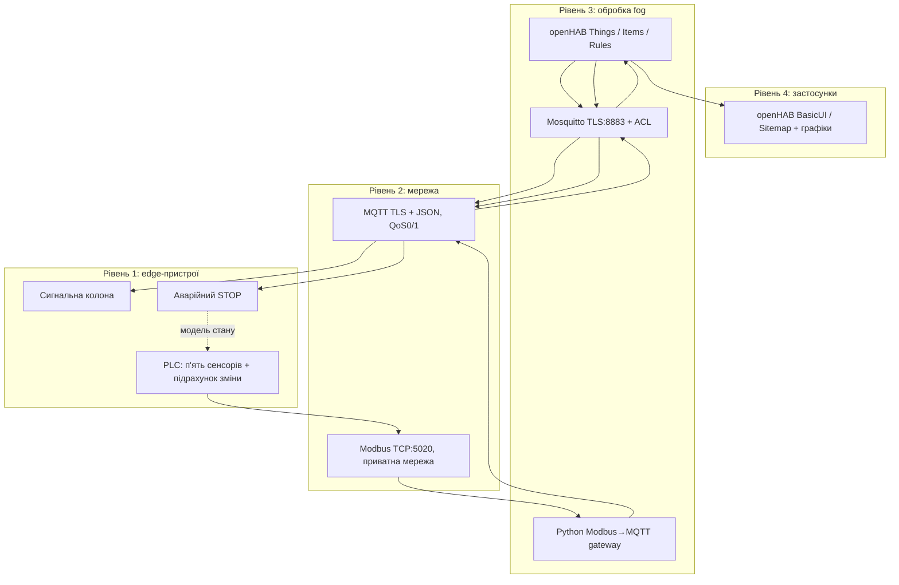

# Модульний контроль №1: IIoT-моніторинг верстата — варіант 4

**Відео:**   
**Автор:** Оксюта Олександр Вікторович. **Статус:** програмні файли підготовлено; фактичний запуск, скріншоти, відео й захист потрібно провести на своєму комп'ютері. **Це навчальна симуляція, не система промислової безпеки.**

## Опис і архітектура

Програма моніторить верстат із двигуном: **вібрацію RMS (мм/с), температуру підшипника (°C), струм двигуна (А), лічильник деталей та стан RUN/IDLE/FAULT**. Є два актуатори: **сигнальна колона GREEN/YELLOW/RED** і **аварійна зупинка ON/OFF**. Дані від PLC з Modbus TCP slave (PyModbus) передає Python-шлюз (paho-mqtt) на TLS-брокер Mosquitto, звідки їх читає openHAB. MQTT-сенсори мають 5 окремих логінів, актуатори — 2, є користувачі `openhab` і `admin`.



**Edge:** PLC генерує правдоподібні значення (база + шум + плавні тренди), рахує деталі й простій. **Fog:** шлюз читає Modbus-регістри кожні 2 с, перетворює їх на JSON, openHAB застосовує правила. **Хмара:** немає; рішення працює локально, конфіденційна виробнича телеметрія не передається назовні.

| Логічний пристрій / MQTT-логін | Вимір або стан |
|---|---|
| `sensor_vibration` | RMS вібрація мм/с |
| `sensor_bearing` | Температура підшипника °C |
| `sensor_current` | Струм двигуна A |
| `sensor_parts` | Загальна й поточна кількість деталей |
| `sensor_machine` | RUN/IDLE/FAULT, номер зміни, простій у хвилинах |
| `actuator_tower` | GREEN / YELLOW / RED, підтверджує `state` |
| `actuator_estop` | ON / OFF, підтверджує `state` |

## Як запустити на Windows у VS Code

Потрібні **Docker Desktop (запущений Engine)**, інтернет для Docker-образів і VS Code. Розпакуй ZIP, **File → Open Folder** → папка `iot-mc1-variant4`. У VS Code відкрий **Terminal → New Terminal** (PowerShell).

**1. Перший запуск — створення CA, TLS, 9 окремих паролів, ACL password hashes та локальної конфігурації openHAB:**

```powershell
powershell -NoProfile -ExecutionPolicy Bypass -File .\scripts\setup.ps1
```

Скрипт використовує Alpine в Docker, генерує `.env`, `certs/ca.crt`, `certs/server.crt`, `certs/server.key`, `certs/truststore.p12`, `mosquitto/config/passwd` і `openhab/conf/things/factory.things`. Вони **не потрапляють у Git**. CA private key не монтується в жоден запущений сервіс.

**2. Запуск усіх сервісів однією командою:**

```powershell
docker compose up -d
```

**3. Перевірка:**

```powershell
docker compose ps
docker compose logs --tail 50 gateway
docker compose logs --tail 50 openhab
```

Відкрий **http://localhost:8080/basicui/app?sitemap=factory**. Перший запуск openHAB може тривати кілька хвилин. Якщо бачиш welcome/setup — створи локальний обліковий запис адміністратора openHAB UI (це не користувач MQTT). Додаткові компоненти `mqtt`, `jsonpath`, `rrd4j`, `basic` інсталюються з `openhab/conf/services/addons.cfg`.

Linux/WSL: `sh scripts/setup.sh`, тоді `docker compose up -d`.  
Зупинити: `docker compose down`; повторити відеозапуск: `docker compose down`, `docker compose up -d`, `docker compose ps`.  
Якщо немає даних — перевір `docker compose logs plc`, `docker compose logs gateway`, `docker compose logs mosquitto`, `docker compose logs openhab`. Якщо Java повідомляє про PKIX, перевір, чи створено truststore: не відключай TLS-перевірку.

## Modbus TCP — карта регістрів

Modbus TCP slave Unit ID **1**, внутрішній Docker-порт **5020**, читання FC03; адреси **0-based**, аналог позначення 40001–40009. Для PyModbus у сховищі початкова адреса 1 враховує внутрішнє зміщення slave context. Дані з PLC оновлюються кожні 2 секунди.

| Адреса | Позначення | Поле | Конвертація |
|---:|---:|---|---|
| 0 | 40001 | Вібрація | UInt16 /100 → мм/с |
| 1 | 40002 | Температура | UInt16 /10 → °C |
| 2 | 40003 | Струм | UInt16 /10 → A |
| 3 | 40004 | Деталі — молодше слово | UInt32, little-word-first |
| 4 | 40005 | Деталі — старше слово | `count=r3+65536*r4` |
| 5 | 40006 | Стан верстата | 0=IDLE, 1=RUN, 2=FAULT |
| 6 | 40007 | Номер зміни | UInt16 |
| 7 | 40008 | Деталей за зміну | UInt16 |
| 8 | 40009 | Простій за зміну | секунди прискореного часу |

Приклад: 532 / 487 / 132 у перших 3 регістрах = 5,32 мм/с; 48,7 °C; 13,2 А. Зміна **8 год = 120 секунд реального часу**, тобто 1 реальна секунда = 240 секунд змодельованого часу. При IDLE/FAULT деталі не накопичуються, простій зростає; кожні 120 с лічильники зміни скидаються.

## MQTT — топіки, payload, QoS, retain, Last Will

| Шаблон теми | Тип | Приклад JSON / статус | QoS / retain |
|---|---|---|---|
| `iiot/line1/<sensor>/telemetry` | Sensor → MQTT | `{"value":2.5,"unit":"mm/s","ts":1761300000}` | 0 / no |
| `iiot/line1/parts/telemetry` | Облік | `{"value":14,"unit":"pcs","ts":1761300000,"shift_count":14,"shift_id":1}` | 0 / no |
| `iiot/line1/machine/telemetry` | Стан | `{"value":"RUN","unit":"state","ts":1761300000,"shift_id":1,"downtime_minutes":2.0}` | 0 / no |
| `iiot/line1/tower/set` | Команда | `{"state":"YELLOW"}` | 1 / no |
| `iiot/line1/estop/set` | Команда | `{"state":"ON"}` | 1 / no |
| `iiot/line1/<actuator>/state` | Підтвердження | `{"state":"ON","ts":1761300000}` | 1 / yes |
| `iiot/line1/<device>/status` | Доступність | `online` / `offline` | 1 / yes |

Телеметрія **QoS 0**: часті оновлення, одна втрата не критична. Команди/підтвердження/доступність **QoS 1**: щонайменше одна доставка. Команда `/set` не retain — після перепідключення випадково не повториться. Кожен із 7 клієнтів публікує `online` з retain, а при аварійному обриві MQTT Last Will опублікує retained `offline`; при втраті Modbus шлюз після 3 помилок також позначає сенсори offline.

**Чому MQTT**, а не CoAP, HTTP, Zigbee або LoRaWAN? Потрібен push-транспорт publish/subscribe для Ethernet-системи, з невеликим накладним трафіком, QoS, retained станами та LWT. HTTP дає переважно request/response, CoAP краще підходить обмеженим вузлам, Zigbee — ближній малопотужній радіомережі, LoRaWAN — віддаленим рідкісним пакетам з обмеженнями швидкості та частоти. Modbus TCP використано саме на польовій ланці PLC → шлюз; MQTT на шлюз → openHAB/актуатори.

## 3 автоматизації та ISO 20816-3

**Правило 1: вібрація.** Вибрано навчальне припущення: велика машина **групи 1, жорстка опора**, вимір RMS на нерухомих частинах, тому для ISO 20816-3:2022 демонстраційно B/C = **4,5 мм/с**, C/D = **7,1 мм/с**. Понад 4,5 → жовта колона/попередження; понад 7,1 → **STOP ON і RED**. У реальному цеху слід спершу визначити групу, опору й застосовний стандарт; для групи 2 з жорсткою опорою межі інші (2,8 і 4,5 мм/с). E-stop **не скидається автоматично**; лише оператор вручну після усунення причини. Пороги можна змінити в UI.

**Правило 2: температура.** Зростання підшипника більше ніж **5 °C за 10 хв** → `LubricationAlarm=ON`, `AlarmMessage=Перевірити змащення`, колона жовта за відсутності STOP. Для відео **10 хв = 30 с**; код зберігає історію показань у пам'яті openHAB і порівнює значення за вікно ~30 с.

**Правило 3: зміна.** PLC обчислює число виготовлених деталей і час IDLE/FAULT, шлюз передає їх до UI, а правило формує `ShiftSummary` та `ShiftEfficiency`. Зміну прискорено: **8 год = 120 с**; демонстраційний план = **40 деталей**, тому % виконання плану = `min(100, partsShift / 40 × 100)`.

openHAB конфігурації: `openhab/conf/things/factory.things.template`, `openhab/conf/items/factory.items`, `openhab/conf/rules/factory.rules` (**3 правила + ініціалізація**), `openhab/conf/sitemaps/factory.sitemap`, `openhab/conf/persistence/rrd4j.persist`. Sitemap відображає **усі сенсори, всі статуси, керування актуаторами, тривоги, два графіки, деталі/простій**.

## Демонстраційні сценарії (команди VS Code)

```powershell
docker compose exec plc python scenario.py warning
```

Очікуване: вібрація ≈5,3 мм/с, **YELLOW**.

```powershell
docker compose exec plc python scenario.py critical
```

Очікуване: ≈8,2 мм/с, **RED, STOP ON, FAULT**.

```powershell
docker compose exec plc python scenario.py normal
```

Очікуване: вібрація нормальна, але **STOP лишається ON**. У UI **вручну** встанови `EmergencyStop OFF` після нормалізації умов.

```powershell
docker compose exec plc python scenario.py heat
```

Приблизно через 30 секунд підшипник нагріється більш ніж на +5 °C, має з'явитися **«Перевірити змащення»**. Потім:

```powershell
docker compose exec plc python scenario.py idle
```

Після цього деталі не додаються, простій зростає. Спостерігай нову зміну після 120 с. Завершення сценаріїв: `docker compose exec plc python scenario.py normal`.

## Захист: TLS/ACL та STRIDE

- Mosquitto: тільки TLS **8883**, 1883 закритий, анонімний доступ заборонено; TLS-сертифікат з власним CA та SAN `mosquitto`, перевірка hostname увімкнена, openHAB має Java truststore з локальним CA.
- **Окремі облікові записи для 5 сенсорів, 2 актуаторів, openHAB, admin.** Кожен сенсор пише тільки свою `telemetry/status`; актуатор читає тільки свій `set`, пише тільки свій `state/status`; openHAB пише тільки два актуаторні `set`. MQTT адміністратор може спостерігати всі теми.
- `.env`, паролі Mosquitto, приватні ключі та згенерований `.things` виключено з Git. Облікові дані не друкуй на скріншотах.

| STRIDE | Загроза | Міра протидії |
|---|---|---|
| S (Spoofing) | підробка даних вібрації чужим клієнтом | окремі логіни, TLS та ACL |
| T (Tampering) | зміна команди E-stop через чужий топік | ACL write тільки для openHAB/admin |
| R (Repudiation) | заперечення аварійної команди | логи брокера й openHAB (у production потрібен незмінний аудит) |
| I (Information disclosure) | витік паролів/телеметрії | TLS, локальна `.env`, ключі поза Git |
| D (Denial of service) | відключення PLC або MQTT | LWT offline, 3 невдалі опитування → offline, ізольована мережа |
| E (Elevation of privilege) | захоплений датчик керує STOP | ACL найменших привілеїв |

Спроби анонімного доступу, plaintext на TLS порту й записи в чужий топік тестуються командою:

```powershell
docker compose exec gateway python security_tests.py
docker compose logs --tail 100 mosquitto
```

Відмову перевір за результатом тесту та логами брокера; **не стверджуй про успішні тести до власного запуску**. Modbus TCP тут незашифрований, але обмежений внутрішньою Docker-мережею — у справжній системі потрібні VLAN/firewall та незалежний safety PLC.

## Що здати та як захистити

1. **GitHub repository** із цими файлами, щонайменше **5 реальних осмислених комітів у різний час**. Не імітуй історію комітів, роби їх під час власної поетапної перевірки/доопрацювання.
2. **Відео 6–10 хв**, власний голос, 1280×720+, усі 8 розділів за `docs/VIDEO_SCRIPT.md`; частини 3–6 одним дублем, без склейок. Відео YouTube «За посиланням» або Drive із доступом за посиланням, URL сюди на початок README та в Classroom.
3. **3–5 реальних скріншотів** у `docs/screenshots/`: `01-docker.png`, `02-ui-normal.png`, `03-stop.png`, `04-lubrication.png`, `05-security.png`. Не додавай згенерованих / фіктивних доказів.
4. **AI_USAGE.md**: прочитай, додай фактичні промпти, власні зміни, зафіксовану помилку та спосіб її виявлення. За вимогами без AI_USAGE.md або відео роботу не оцінюють.
5. **Захист наживо:** будь готовий змінити поріг в UI, змінити конфігурацію, пояснити `r[0]/100`, розрізнити QoS 0/1, ACL vs password, роботу LWT та обмеження Modbus.

**Перевірка вихідних файлів (без Docker):** `python scripts/test_static.py` (потрібен PyYAML). **Docker та openHAB у середовищі підготовки архіву не запускалися**, отже для твердження про готову працюючу систему необхідна твоя локальна end-to-end перевірка.

## Джерела для перевірки

- [PyModbus 3.8.6: сервер](https://pymodbus.readthedocs.io/en/v3.8.6/source/server.html), [клієнт](https://pymodbus.readthedocs.io/en/v3.8.6/source/client.html), [datastore](https://pymodbus.readthedocs.io/en/v3.8.6/source/library/datastore.html)
- [openHAB MQTT binding](https://www.openhab.org/addons/bindings/mqtt/), [Rules DSL](https://www.openhab.org/docs/configuration/rules-dsl), [Persistence](https://www.openhab.org/docs/configuration/persistence), [Docker](https://www.openhab.org/docs/installation/docker)
- [Mosquitto authentication and passwords](https://mosquitto.org/documentation/authentication-methods/)
- [ISO 20816-3:2022 — таблиця меж для груп 1 і 2](https://www.shinkawa.co.jp/useful/technical-column_04). Пороги адаптуються до конкретного типу устаткування.
